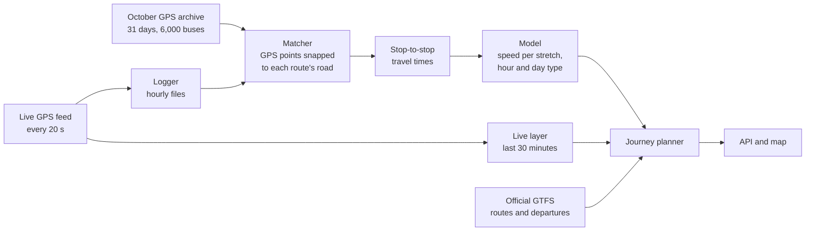

<div align="center">

# Delhi bus times

**How long will this bus trip take at the hour you leave?**
A Delhi journey planner timed by real bus GPS, not by the timetable.

[](https://whereuelevate.com/drills/transport-stack-hackathon-2026?w_ref=J66P10)


</div>

<!-- Hero image: put a GIF or screenshot from the demo video at docs/demo.gif and uncomment the line below. -->
<!-- <p align="center"></p> -->

The Delhi timetable gives the same travel time at 8:30 am and at 11 pm. Real buses don't. We trained a
travel-time model on **a full month of GPS from about 6,000 Delhi buses**: every stretch of road
between two stops, at every hour, on weekdays and weekends. A journey planner uses that model to time
your trip for the hour you leave.

## The model is the product

Most bus planners read the timetable. This one learns from where the buses really were.

| From | To | How |
| --- | --- | --- |
| **31 days of raw bus GPS**<br/>1 to 31 October 2026, from the organisers' archive, 124 GB unpacked | **420+ million clean positions** | Duplicates removed, kept at one point per bus every 15 s, off-Delhi points dropped |
| 420+ million positions | **39.1 million timed stretches** | Each point snapped to its bus's route on the road map. Jumps, backward moves and impossible speeds thrown out. The moment the bus passed each stop worked out from the points either side |
| 39.1 million timed stretches | **One 6.5 MB model** | Speed for 13,525 stretches, with 205,974 stretch-and-hour corrections and a city traffic curve for every hour, weekday and weekend |
| One model | **A journey in 0.4 s** | Planner, API and 3D map on a laptop, no GPU |

The test is strict: the model is trained on 1 to 24 October and judged on **25 to 31 October, a week
it never saw**, against 50,000 real bus trips.

## In numbers

| | |
| --- | --- |
| **40% lower error than the timetable** | 3.45 min mean error per real bus trip in the unseen week, against 5.72 min for the official timetable |
| **Better at all 24 hours** | the model beats the timetable at every hour of the day, peak and off-peak |
| **73% of estimates within ±20%** | against 42% for the timetable, on the same 50,000 trips of 5 to 30 stops |
| **55% lower median error** | 1.57 min, against 3.51 min for the timetable |
| **6,689 buses, 2,327 routes** | DTC buses from the archive and every DTC and cluster bus in our own live log |
| **61% within ±20% of Google Maps** | door to door, on 33 bus trips across 11 Delhi pairs and 3 times of day |
| **Live every 20 seconds** | positions of every DTC and cluster bus that reports, adjusting trips that leave now |
| **0.4 s per journey plan** | up to 3 options, door to door |

> **Where the numbers come from.** Model and test: the organisers' October 2026 DTC bus GPS, plus our
> own GTFS-RT log of 16 and 17 November 2026. Google Maps times were read by hand on 17 November 2026.
> The full report, by hour, is at `/accuracy` once the app is running.

## Run it in 2 minutes

You need **Python 3.10 or newer** and **git**. No API key is needed to try it.

**1. Get the code**

```bash
git clone https://github.com/Aryanban/transport-stack-hackathon-2026.git
```

```bash
cd transport-stack-hackathon-2026
```

**2. Install** (a private Python environment, so nothing touches your system)

```bash
python3 -m venv .venv
```

```bash
source .venv/bin/activate
```

On Windows, run `.venv\Scripts\activate` instead.

```bash
pip install -r requirements.txt
```

**3. Start it**

```bash
python -m uvicorn src.ps1.api:app --port 8020
```

**4. Open http://127.0.0.1:8020/** and type a start and end, for example *Kashmere Gate ISBT* to
*Nehru Place*.

The first start takes about 5 seconds, because it builds a network cache from the bundled timetable.
After that it starts in about 1 second.

### Optional: live buses

Live buses on the map and live delays need a Delhi Transport Stack key.

1. Register at [delhi.transportstack.in](https://delhi.transportstack.in) and request the GTFS-RT feed.
2. Copy `.env.example` to `.env`.
3. Put your key on the line `DTS_API_KEY=`.
4. Restart the server.

Without a key, everything else works. Journeys use the learned model and the map shows no live buses.
Nothing is ever simulated.

## What you can do

- **Plan a trip.** Give a start and end as stop names, `lat,lon`, or your current location, and a time
  to leave. You get up to 3 options, each with:
  - the walk to the stop
  - which bus to take and in which direction
  - when it is due and how many stops you ride
  - where to change buses
  - where to get off
  - the total time and the fare
- **See the effect of traffic.** *Same trip, every hour* shows the door-to-door time from 5 am to
  11 pm, so you can pick a quieter hour.
- **Know how much to trust it.** Every option says what share of the ride is on stretches timed by
  real buses, and which hour's data it uses.
- **Watch the city move.**
  - *Live buses* shows every bus reporting now, pointed the way it is driving.
  - *Speeds* colours each road stretch by its predicted bus speed.
- **Look up any bus by number.** For example `534` shows the full path, every stop, the first and last
  bus, and how often it runs.
- **See the next buses at any stop**, and share any plan as a link.

## How it works



1. **Snap GPS to roads.** Each bus position is projected onto its route's shape. Points more than 60 m
   off the road, points that jump backwards, and points implying over 90 km/h are dropped.
2. **Time every stretch.** The moment a bus passes each stop is interpolated from the GPS points on
   either side. Two stops in a row give one timed stretch. Stops and signals are included, because
   riders sit through them too.
3. **Learn speeds.** The time on a stretch is a distance baseline × a city traffic factor for that hour
   and day type × that stretch's own factor × its own factor at that hour.
   - A stretch with few buses stays close to the city-wide pattern.
   - A busy stretch follows its own data.
4. **Adjust live.** The last 30 minutes of the live feed change the estimate for anyone leaving now.
   The adjustment fades out for trips an hour away.
5. **Plan.** The timetable only says which routes exist and when each bus leaves its first stop.
   Everything after that is predicted by the model, one hour at a time along the ride.

The [technical note](docs/hackathon/PS1_SUBMISSION.md) has the formulas, the parameters and the
validation method.

## Accuracy

**The test.** Train on 1 to 24 October. Then predict real bus trips from 25 to 31 October, a week the
model never saw. Each trip is 5 to 30 stops of one real bus, timed by its GPS. 50,000 trips are sampled
from the week.

| On 50,000 bus trips in the unseen week | Mean error | Median error | % error | Within ±20% |
| --- | --- | --- | --- | --- |
| **This model** | **3.45 min** | **1.57 min** | **15.1%** | **73.4%** |
| Official timetable | 5.72 min | 3.51 min | 29.1% | 41.9% |
| One flat city speed | 5.88 min | 3.83 min | 32.0% | 39.5% |

That is 40% less error than the timetable, 14 points lower percentage error and 31.5 more points
within ±20%.

| | Model | Timetable |
| --- | --- | --- |
| Peak hours (8 to 10 am, 5 to 8 pm) | 3.82 min | 6.04 min |
| Off-peak | 3.16 min | 5.48 min |
| 6 pm, the worst hour | 5.50 min | 9.31 min |
| 5 am | 1.51 min | 6.43 min |

On average the model is 2.3 min short on these trips. It predicts the typical (median) time, and a few
very slow trips pull the average up.

**Same trip, different hour.** Kashmere Gate ISBT to Nehru Place, Tuesday 24 November:

| Leave at | 5 am | 8 am | 12 noon | 6 pm | 10 pm |
| --- | --- | --- | --- | --- | --- |
| Bus ride, this model | 31.5 min | 41.5 min | 62.3 min | 78.6 min | 47.6 min |
| Bus ride, timetable | 48.3 min | 48.3 min | 48.3 min | 48.3 min | 48.3 min |

On Saturday 28 November, the 6 pm ride drops to 74.4 min.

**Against Google Maps.** We took 33 trips: 11 Delhi pairs at 8:30 am, 2 pm and 9:30 pm, with Google's
best bus-only option for each, read on 17 November 2026.

- Our door-to-door time is **within ±20% of Google's on 61%** of trips.
- The mean difference is **13.5 min**, and ours is 6.6 min shorter on average.
- Most of the gap is one pair, Dhaula Kuan to ITO, where Google's best bus takes 92 to 121 min and
  ours 38 to 62 min. Without it: 67% within ±20%, 9.4 min mean difference.
- Google's bus times are timetable estimates too, so this is a comparison, not ground truth.

The pairs and both times are in `data/ps1/google_benchmark.csv` and on the `/accuracy` page.

## Rebuild the model yourself

The repository ships the fitted model, so you don't need any of this to run the app. To rebuild it
from raw GPS, you need about 20 GB of free disk, 16 GB of RAM and 3 hours.

1. Download the October archive (16.1 GB) from the
   [hackathon page](https://delhi.transportstack.in/hackathon/) into `data/raw/`, and check it
   against the published `SHA256SUMS`.
2. Install 7-Zip (`brew install sevenzip` on a Mac, `7zz` on the path).
3. Turn each day into timed stretches. Each day is unpacked, matched and deleted, 2 at a time:

```bash
python -m src.ps1.october
```

4. Fit the model, then run the held-out test and the Google comparison:

```bash
python -m src.ps1.model && python -m src.ps1.validation
```

To add your own live data, run `python scripts/log_gtfs_rt.py` (it needs a key) and then
`python -m src.ps1.matcher` before step 4.

## API

Every screen in the app is built on a public JSON API. Interactive docs are at
http://127.0.0.1:8020/docs.

```bash
curl "http://127.0.0.1:8020/journeys?from=Kashmere%20Gate%20ISBT&to=Nehru%20Place&depart=08:30"
```

| Endpoint | What it returns |
| --- | --- |
| `GET /journeys?from=&to=&depart=` | Up to 3 journey options with legs, times, fares and directions |
| `GET /journeys/day?from=&to=&date=` | Door-to-door time for the same trip at each hour |
| `GET /stops?q=` | Stops matching a name |
| `GET /stops/all` | Every served stop as GeoJSON |
| `GET /stops/{id}/departures` | Next buses at a stop |
| `GET /routes?q=` | Routes matching a bus number |
| `GET /routes/{id}` | A route's path, stops, first and last bus, and how often it runs |
| `GET /traffic/hours` | City-wide congestion factor by hour and day type |
| `GET /traffic/stretches?hour=&daytype=` | Predicted speed on each stretch, as GeoJSON |
| `GET /live/status` | Live feed status |
| `GET /live/vehicles?route=` | Live bus positions, optionally for one route |
| `GET /metro/network` | Metro stations, for map context |
| `GET /validation` | The held-out accuracy report |

## Honest limits

- **Cluster buses.** The October archive is DTC buses only. Cluster (DIMTS) routes are learned from
  our own 2 days of live log, so they have less data. Every option shows how much of its ride rests
  on timed stretches.
- **Holidays and events.** October has weekdays and weekends, but the model has no holiday or rain
  factor yet.
- **It predicts the typical time.** The worst trips on a bad day take longer than the estimate.
- **At most one change of bus.** Metro stations are shown for reference; plans are bus only.
- **No crowding levels yet.** October ticket data has just been published. Until it is built in, no
  crowd levels are shown.
- **The wait for the first bus** uses the timetable, unless a live bus is already on its way.

## Repository

```
src/ps1/                 planner, travel-time model, GPS matcher, live layer, API and web app
src/ps1/october.py       turns the October GPS archive into timed stretches, one day at a time
src/gtfs_rt_client.py    live GTFS-RT client (live data only, never simulated)
scripts/log_gtfs_rt.py   logs the live feed to data/gps_log/ (hourly gzip CSV, ~13 bytes a position)
data/delhi_buses_gtfs/   official static GTFS v32
data/ps1/                fitted model (model.json), validation report, Google benchmark
data/raw/                October archive and per-day stretch timings (not in git, about 1 GB after processing)
docs/hackathon/          problem statements and the PS1 technical note
tests/                   test suite
```

## Tests

```bash
PYTHONPATH=. python -m pytest tests/ -q
```

## Credits

- Data: Delhi Transport Stack (GTFS, GTFS-RT and the October 2026 bus GPS archive, Transport Stack /
  IIIT Delhi) and DMRC metro station locations.
- Map: [MapLibre GL](https://maplibre.org) and [OpenFreeMap](https://openfreemap.org) tiles, with
  data © OpenStreetMap contributors.
- Built for the Transport Stack Hackathon 2026.
