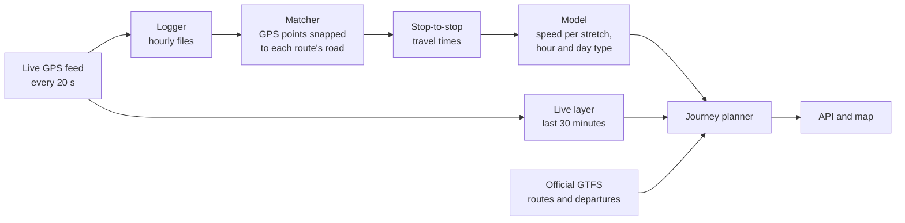

<div align="center">

# Delhi bus times

**How long will this bus trip take at the hour you leave?**
A Delhi journey planner timed by real bus GPS, not by the timetable.

[](https://whereuelevate.com/drills/transport-stack-hackathon-2026?w_ref=J66P10)


</div>

<!-- Hero image: put a GIF or screenshot from the demo video at docs/demo.gif and uncomment the line below. -->
<!-- <p align="center"></p> -->

The Delhi timetable gives the same travel time at 8:30 am and at 11 pm. Real buses don't. This app
watches thousands of Delhi buses through their live GPS. It learns how fast they really move on each
stretch of road at each hour, and plans your trip with those speeds.

## In numbers

| | |
| --- | --- |
| **43% lower error than the timetable** | 1.27 min mean error per held-out bus sub-trip, against 2.21 min for the official timetable |
| **78% of estimates within ±20%** | against 53% for the timetable, on the same 1,735 real bus sub-trips |
| **67% within ±20% of Google Maps** | door to door, on 33 bus trips across 11 Delhi pairs and 3 times of day |
| **8,231 road stretches learned** | from 52,914 GPS-timed stretch passes by 4,541 buses on 1,362 routes |
| **The whole Delhi network** | 6,862 stops, 2,574 routes and 80,357 scheduled trips from the official GTFS |
| **Live every 20 seconds** | positions of every DTC and cluster bus that reports, 5,699 in the 5 pm hour on 16 November |
| **0.4 s per journey plan** | up to 3 options, door to door, on a laptop |

> **Read this before quoting the numbers.** The accuracy figures come from GPS logged on one evening
> (16 November 2026, 17:00 to 17:45). Hours with no data yet use the city-wide pattern and say so on
> screen. We will refit once a week of data is logged and update this table.
> The full report is at `/accuracy` once the app is running.

## Run it in 2 minutes

You need **Python 3.10 or newer** and **git**. No API key is needed to try it.

**1. Get the code**

```bash
git clone https://github.com/Aryanban/transport-stack-hackathon-2026.git
```

```bash
cd transport-stack-hackathon-2026
```

**2. Install** (a private Python environment, so nothing touches your system)

```bash
python3 -m venv .venv
```

```bash
source .venv/bin/activate
```

On Windows, run `.venv\Scripts\activate` instead.

```bash
pip install -r requirements.txt
```

**3. Start it**

```bash
python -m uvicorn src.ps1.api:app --port 8020
```

**4. Open http://127.0.0.1:8020/** and type a start and end, for example *Kashmere Gate ISBT* to
*Nehru Place*.

The first start takes about 5 seconds, because it builds a network cache from the bundled timetable.
After that it starts in about 1 second.

### Optional: live buses

Live buses on the map and live delays need a Delhi Transport Stack key.

1. Register at [delhi.transportstack.in](https://delhi.transportstack.in) and request the GTFS-RT feed.
2. Copy `.env.example` to `.env`.
3. Put your key on the line `DTS_API_KEY=`.
4. Restart the server.

Without a key, everything else works. Journeys use the learned model and the map shows no live buses.
Nothing is ever simulated.

## What you can do

- **Plan a trip.** Give a start and end as stop names, `lat,lon`, or your current location, and a time
  to leave. You get up to 3 options, each with:
  - the walk to the stop
  - which bus to take and in which direction
  - when it is due and how many stops you ride
  - where to change buses
  - where to get off
  - the total time and the fare
- **See the effect of traffic.** *Same trip, every hour* shows the door-to-door time from 5 am to
  11 pm, so you can pick a quieter hour.
- **Know how much to trust it.** Every option says what share of the ride is on stretches with real
  logged buses, and which hour's data it uses.
- **Watch the city move.**
  - *Live buses* shows every bus reporting now, pointed the way it is driving.
  - *Speeds* colours each road stretch by its predicted bus speed.
- **Look up any bus by number.** For example `534` shows the full path, every stop, the first and last
  bus, and how often it runs.
- **See the next buses at any stop**, and share any plan as a link.

## How it works



1. **Snap GPS to roads.** Each bus position is projected onto its route's shape. Points more than 60 m
   off the road, points that jump backwards, and points implying over 90 km/h are dropped.
2. **Time every stretch.** The moment a bus passes each stop is interpolated from the GPS points on
   either side. Two stops in a row give one timed stretch. Stops and signals are included, because
   riders sit through them too.
3. **Learn speeds.** The time on a stretch is a distance baseline × an hour-of-day factor × that
   stretch's own factor, by hour.
   - A stretch with few buses stays close to the city-wide pattern.
   - A busy stretch follows its own data.
4. **Adjust live.** The last 30 minutes of the live feed change the estimate for anyone leaving now.
   The adjustment fades out for trips an hour away.
5. **Plan.** The timetable only says which routes exist and when each bus leaves its first stop.
   Everything after that is predicted by the model, one hour at a time along the ride.

The [technical note](docs/hackathon/PS1_SUBMISSION.md) has the formulas, the parameters and the
validation method.

## Accuracy

The test uses whole sub-trips of real buses, 5 to 30 stops long, that the model never saw during
fitting.

| On 1,735 held-out bus sub-trips | Mean error | Median error | % error | Within ±20% |
| --- | --- | --- | --- | --- |
| **This model** | **1.27 min** | **1.02 min** | **12.9%** | **78.3%** |
| Official timetable | 2.21 min | 1.80 min | 23.2% | 52.9% |
| One flat city speed | 2.18 min | 1.70 min | 23.3% | 55.2% |

Compared with the timetable, that is 43% less error, 10.3 points lower percentage error and 25.4 more
points within ±20%.

To rebuild the model and the report from your own logged GPS:

```bash
python scripts/log_gtfs_rt.py
```

This logger needs a key. Leave it running for days, with the computer awake and plugged in. Then run:

```bash
python -m src.ps1.matcher && python -m src.ps1.model && python -m src.ps1.validation
```

**Against Google Maps.** We took 33 trips: 11 Delhi pairs at 8:30 am, 2 pm and 9:30 pm, with Google's
best bus-only option for each, read on 17 November 2026.

- Our door-to-door time is **within ±20% of Google's on 67%** of trips.
- The mean difference is **12.1 min**.
- Google's bus times are timetable estimates too, so this is a comparison, not ground truth.

The pairs and both times are in `data/ps1/google_benchmark.csv` and on the `/accuracy` page.

## API

Every screen in the app is built on a public JSON API. Interactive docs are at
http://127.0.0.1:8020/docs.

```bash
curl "http://127.0.0.1:8020/journeys?from=Kashmere%20Gate%20ISBT&to=Nehru%20Place&depart=08:30"
```

| Endpoint | What it returns |
| --- | --- |
| `GET /journeys?from=&to=&depart=` | Up to 3 journey options with legs, times, fares and directions |
| `GET /journeys/day?from=&to=&date=` | Door-to-door time for the same trip at each hour |
| `GET /stops?q=` | Stops matching a name |
| `GET /stops/all` | Every served stop as GeoJSON |
| `GET /stops/{id}/departures` | Next buses at a stop |
| `GET /routes?q=` | Routes matching a bus number |
| `GET /routes/{id}` | A route's path, stops, first and last bus, and how often it runs |
| `GET /traffic/hours` | City-wide congestion factor by hour and day type |
| `GET /traffic/stretches?hour=&daytype=` | Predicted speed on each stretch, as GeoJSON |
| `GET /live/status` | Live feed status |
| `GET /live/vehicles?route=` | Live bus positions, optionally for one route |
| `GET /metro/network` | Metro stations, for map context |
| `GET /validation` | The held-out accuracy report |

## Honest limits

- **One evening of data so far.** Hours with no logged buses fall back to the city-wide pattern, and
  the app says so on every option.
- **Weekends and holidays** need their own logged days before they differ from weekdays.
- **At most one change of bus.** Metro stations are shown for reference; plans are bus only.
- **No crowding levels.** They need real ETM ticket data, which we don't have yet, so none are shown.
- **The wait for the first bus** uses the timetable, unless a live bus is already on its way.

## Repository

```
src/ps1/                 planner, travel-time model, GPS matcher, live layer, API and web app
src/gtfs_rt_client.py    live GTFS-RT client (live data only, never simulated)
scripts/log_gtfs_rt.py   logs the live feed to data/gps_log/ (hourly gzip CSV, ~13 bytes a position)
data/delhi_buses_gtfs/   official static GTFS v32
data/ps1/                fitted model, validation report, Google benchmark template
docs/hackathon/          problem statements and the PS1 technical note
tests/                   test suite
```

## Tests

```bash
PYTHONPATH=. python -m pytest tests/ -q
```

## Credits

- Data: Delhi Transport Stack (GTFS and GTFS-RT) and DMRC metro station locations.
- Map: [MapLibre GL](https://maplibre.org) and [OpenFreeMap](https://openfreemap.org) tiles, with
  data © OpenStreetMap contributors.
- Built for the Transport Stack Hackathon 2026.
