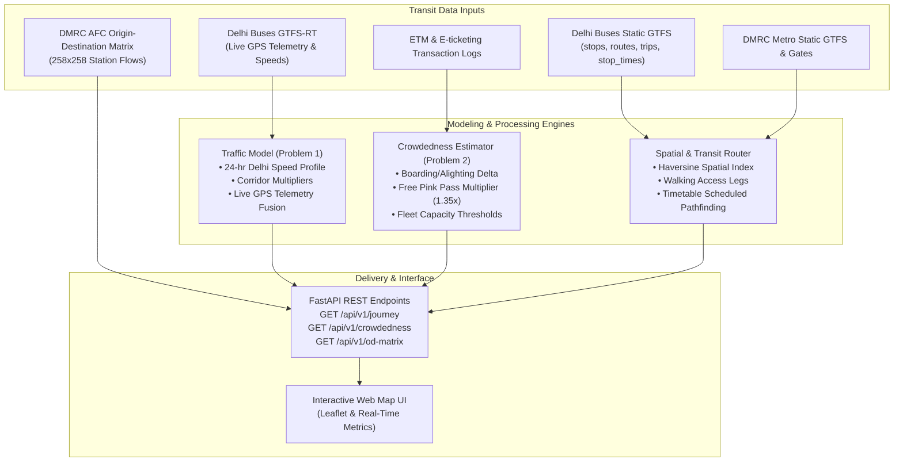

# Transport Stack Hackathon 2026 — Delhi Transit Engine

[](https://whereuelevate.com/drills/transport-stack-hackathon-2026?w_ref=J66P10)
[](https://delhi.transportstack.in/hackathon/)
[](https://delhi.transportstack.in/)
[](https://fastapi.tiangolo.com)
[](https://www.python.org/)

Official data repository, mathematical modeling engine, and prototype implementation for the **Transport Stack Hackathon 2026**, hosted on [Where U Elevate](https://whereuelevate.com/drills/transport-stack-hackathon-2026?w_ref=J66P10) by **Transport Stack** (Japan International Cooperation Agency - JICA, Chartr, Centre for Sustainable Mobility - CSM at IIIT Delhi, and Airawat Research Foundation - ARF at IIT Kanpur).

---

## 📌 Executive Summary

Delhi's public transit network generates massive data streams: thousands of buses transmitting high-frequency GPS telemetry, millions of smart-card metro AFC taps, and conductor ETM / e-ticketing logs.

This repository provides an end-to-end open-source system tackling **Phase 1** challenges:
1. **Problem 1 (Traffic Model & Journey Planner):** Harnesses the Delhi bus fleet as moving velocity sensors, converting historical and real-time GTFS-RT feeds into dynamic travel-time predictions that outperform static timetables and reflect actual road congestion.
2. **Problem 2 (Crowdedness-Aware Journey Planner):** Estimates passenger loads along route segments using ticketing transactions and pass-holder multipliers (accounting for Delhi's ~35% non-ticketed daily pink passes), classifying trips into intuitive comfort tiers: **Seats Available**, **Standing Room**, and **Heavily Crowded**.
3. **Phase 2 Extensibility:** Pre-loads DMRC station gate coordinates, hourly footfalls, and the 258×258 Origin-Destination passenger matrix for feeder bus routing (Problem 4) and OD extrapolation (Problem 3).

---

## 🏗️ Architecture & Mathematical Formulations



### 1. Traffic-Adjusted Travel Time Formulation (Problem 1)

Static timetables assume constant speeds ($\sim 18\text{ km/h}$). Actual Delhi bus speeds fluctuate from **$11.5\text{ km/h}$** during peak hours to **$35\text{ km/h}$** late at night:

$$\hat{v}(h, c) = \frac{v_{\text{base}}(h)}{\kappa_c}$$

Where:
- $v_{\text{base}}(h)$ is the historical time-of-day speed curve at hour $h \in [0, 23]$.
- $\kappa_c$ is the corridor congestion penalty factor ($\kappa_{\text{Ring Road}} = 1.25$, $\kappa_{\text{ITO}} = 1.40$).
- When live GTFS-RT vehicle telemetry is available, the model fuses real-time and historical speeds:
  $$v_{\text{fused}} = 0.70 \cdot v_{\text{live}} + 0.30 \cdot \hat{v}(h, c)$$

Total predicted travel time over distance $D$ across $N$ intermediate stops and $S$ intersections:
$$T_{\text{predicted}} = \left(\frac{D}{v_{\text{fused}}} \cdot 60\right) + \left(N \cdot \tau_{\text{dwell}}\right) + \left(S \cdot \tau_{\text{signal}}\right)$$

### 2. Crowdedness & Passenger Load Formulation (Problem 2)

Occupancy on route $r$ at time $t$ over segment $k$:

$$L_k = \left( \sum_{i=1}^{k} B_i - \sum_{i=1}^{k} A_i \right) \cdot \alpha_{\text{pass}}$$

Where:
- $B_i$ is boarding ticket counts, $A_i$ is alighting counts.
- $\alpha_{\text{pass}} = 1.35$ accounts for pass holders (female passengers utilizing Delhi's zero-fare daily pink tickets and student bus passes).
- **Classification Criteria:**
  - $\frac{L_k}{C_{\text{seats}}} \le 0.75 \implies$ **Seats Available** (🟢 Green, Comfort $\ge 70$)
  - $0.75 < \frac{L_k}{C_{\text{seats}}} \le 1.25 \implies$ **Standing Room Only** (🟡 Amber, Comfort $35\text{--}69$)
  - $\frac{L_k}{C_{\text{seats}}} > 1.25 \implies$ **Heavily Crowded / Packed** (🔴 Red, Comfort $< 35$)

---

## 📂 Repository Directory Layout

```
transport-stack-hackathon-2026/
├── data/                                  # Loaded Transit Datasets & Matrices
│   ├── delhi_buses_gtfs/                  # Full Delhi Buses Static GTFS (6,812 stops, 2,554 routes, 65,322 trips, 2.38M stop times, 765k shapes)
│   ├── delhi_metro_gtfs/                  # Delhi Metro Static GTFS (DMRC lines & stations)
│   ├── delhi_shared_mobility_gtfs/        # Delhi Shared Mobility GTFS (routes, stops, trips, frequencies)
│   ├── delhi_road_network/                # Data_Layer_04_Road.xlsb (road dimensions, widths >6m for feeder buses)
│   ├── delhi_metro_gates/                 # DMRC Station Gate Geocodes (.xlsx)
│   ├── delhi_metro_footfall/              # Hourly Station Entry/Exit Counts (.xlsx)
│   ├── delhi_metro_od_matrix/             # 258x258 Origin-Destination Flow Matrix & Station Index
│   ├── delhi_metro_parking/               # Metro Parking Lots & Capacities
│   ├── rapid_rail_ncrtc_gtfs/             # NCRTC Rapid Rail GTFS Schedules
│   └── ancillary_images/                  # Streetlight, shop & subway survey assets
├── docs/
│   ├── hackathon/
│   │   ├── OVERVIEW.md                    # Hackathon rules, dates, prizes, and timeline
│   │   ├── FAQS.md                        # Official FAQs from Where U Elevate
│   │   ├── DATASET_CATALOG.md             # Complete metadata of all 15 DTS datasets
│   │   ├── PROBLEM_1_BUS_TRAVEL_TIME.md   # Google Doc brief for Problem 1
│   │   ├── PROBLEM_2_CROWDEDNESS_PLANNER.md# Google Doc brief for Problem 2
│   │   ├── PROBLEM_3_OD_MATRIX.md         # Google Doc brief for Problem 3
│   │   ├── PROBLEM_4_METRO_FEEDER.md      # Google Doc brief for Problem 4
│   │   └── PROBLEM_5_METRO_BUS_CROWDING.md# Google Doc brief for Problem 5
│   └── metadata/                          # Official DTS metadata PDFs & license agreements
├── src/
│   ├── data_loader.py                     # Universal GTFS & OD matrix parser + spatial indexer
│   ├── traffic_model.py                   # Problem 1: Bus traffic velocity & delay model
│   ├── crowdedness_model.py               # Problem 2: ETM ticket occupancy & comfort model
│   ├── gtfs_router.py                     # Multimodal pathfinding engine (walking + bus + metro)
│   ├── api.py                             # FastAPI REST endpoints
│   └── web/
│       └── index.html                     # Interactive Leaflet transit UI & trip planner
├── scripts/
│   └── download_dts_data.py               # Script to sync new datasets from DTS portal
├── tests/
│   └── test_engine.py                     # Comprehensive pytest test suite
├── requirements.txt                       # Python dependencies
├── pyproject.toml                         # Package configuration
└── README.md                              # This documentation
```

---

## 🚀 Quickstart Guide

### 1. Clone & Set Up Virtual Environment

```bash
git clone https://github.com/Aryanban/transport-stack-hackathon-2026.git
cd transport-stack-hackathon-2026

python3 -m venv .venv
source .venv/bin/activate
pip install -r requirements.txt
```

### 2. Run the Test Suite

```bash
pytest -v
```

### 3. Launch the REST API & Web UI

```bash
uvicorn src.api:app --host 0.0.0.0 --port 8000 --reload
```
Open **[http://127.0.0.1:8000](http://127.0.0.1:8000)** in your browser to interact with the map-based journey planner and real-time crowdedness visualizer.

---

## 📡 REST API Reference

| Endpoint | Method | Parameters | Description |
| :--- | :--- | :--- | :--- |
| `/api/v1/health` | `GET` | None | Returns loaded dataset statistics and health status. |
| `/api/v1/journey` | `GET` | `from`, `to`, `depart`, `mode` | **Primary Phase 1 Journey Planner API**. Returns multi-option routes, traffic delays, and crowdedness badges. |
| `/api/v1/stops` | `GET` | `q`, `lat`, `lon`, `limit` | Searches stops by name or finds closest stops to GPS coordinates. |
| `/api/v1/routes` | `GET` | `mode`, `limit` | Lists available bus and metro transit routes. |
| `/api/v1/traffic/speed-profile` | `GET` | None | Returns the 24-hour speed profile (km/h) across Delhi corridors. |
| `/api/v1/crowdedness` | `GET` | `route_id`, `hour`, `progress` | Returns passenger occupancy estimate and recommendation. |
| `/api/v1/od-matrix` | `GET` | `origin` | Returns Origin-Destination passenger flows from DMRC AFC records. |
| `/api/v1/gps-telemetry` | `POST` | `GPSUpdatePayload` | Ingests real-time GTFS-RT vehicle position and speed updates. |

### Sample API Call (Problem 1 & 2 Query):

```bash
curl "http://127.0.0.1:8000/api/v1/journey?from=Rohini%20Sec%2022%20Terminal&to=Azadpur%20Terminal&depart=08:30:00" | jq .
```

---

## 📋 Hackathon Submission Requirements (Phase 1)

Before the deadline on **20 November 2026**:
1. **Registered Team:** Team of 2–3 on [Where U Elevate](https://whereuelevate.com/drills/transport-stack-hackathon-2026?w_ref=J66P10).
2. **Problem Selection:** Either Problem 1 (Bus travel-time planner) or Problem 2 (Crowdedness-aware planner).
3. **Repository URL:** Submit this GitHub repository URL.
4. **Deliverables:**
   - Proposal document & working prototype
   - Source code with this README
   - Short technical note (methodology & validation)
   - Short demo video walkthrough

---

## 👥 Contributors & Team

- **Aryan Bansal** ([@Aryanban](https://github.com/Aryanban))
- Developed for the **Transport Stack Hackathon 2026** (Delhi Transport Stack / JICA / CSM @ IIIT Delhi).

## 📄 License
This project is open-source under the Apache 2.0 / MIT License. Data assets are governed by the Delhi Open Transit Data and Delhi Transport Stack license agreements.
