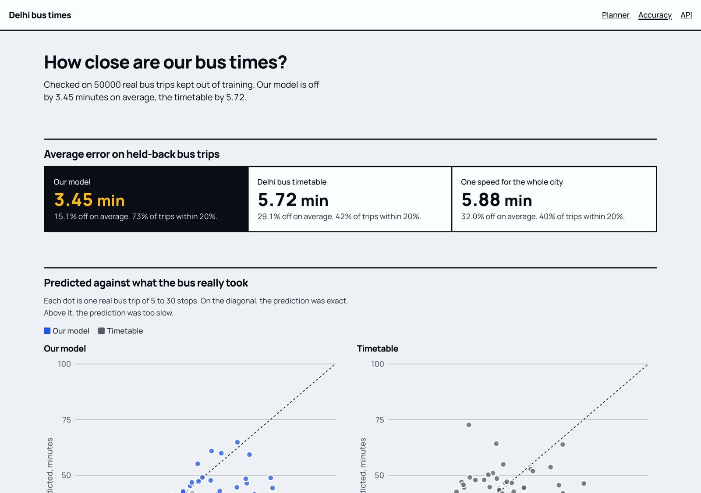
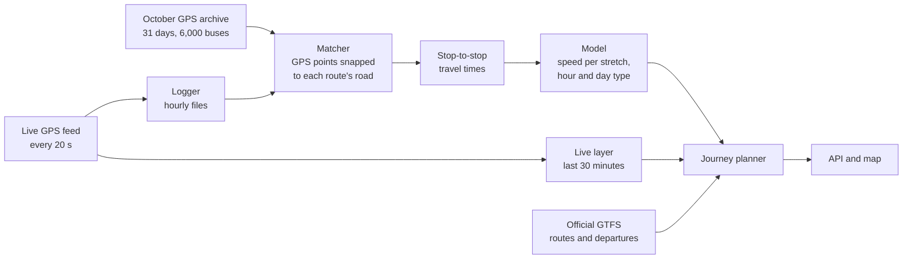

<div align="center">

# 🚌 Delhi bus times

### How long will your bus trip *really* take, at the hour you leave?

A Delhi journey planner timed by **a month of real bus GPS**, not by the timetable.

[](https://whereuelevate.com/drills/transport-stack-hackathon-2026?w_ref=J66P10)


[**Quick start**](#-quick-start) · [**Try these trips**](#-try-these-trips) · [**Accuracy**](#-accuracy) · [**How it works**](#-how-it-works) · [**API**](#-api)

<br/>


<sub>Kashmere Gate ISBT to Nehru Place, leaving 6 pm on a weekday: 79 min on route 425UP by our model. Its timetable says 51.</sub>

</div>

<br/>

The Delhi timetable gives the same travel time at 8:30 am and at 11 pm. Real buses don't.

We trained a travel-time model on **39.1 million timed road stretches from 6,689 Delhi buses**, taken
from 31 days of GPS. It knows every stretch between two stops, at every hour, on weekdays and weekends.
The planner uses it to time your trip for the hour you leave.

<table>
<tr>
<td align="center" width="25%"><h3>40%</h3>lower error than the timetable, on a week the model never saw</td>
<td align="center" width="25%"><h3>73%</h3>of trips within ±20%<br/>(timetable: 42%)</td>
<td align="center" width="25%"><h3>24 / 24</h3>hours of the day where the model beats the timetable</td>
<td align="center" width="25%"><h3>0.4 s</h3>per journey plan, on a laptop, no GPU</td>
</tr>
</table>

<sub>All numbers are measured, not estimated. Where each comes from is in [Accuracy](#-accuracy).</sub>

## Contents

- [Quick start](#-quick-start)
- [Try these trips](#-try-these-trips)
- [What you can do](#-what-you-can-do)
- [The model is the product](#-the-model-is-the-product)
- [Accuracy](#-accuracy)
- [How it works](#-how-it-works)
- [API](#-api)
- [Rebuild the model yourself](#-rebuild-the-model-yourself)
- [Honest limits](#-honest-limits)
- [Repository layout](#-repository-layout)
- [Credits](#-credits)

## ⚡ Quick start

**You need:** Python 3.10 or newer, git, and about 450 MB of disk (code, data and Python packages). **No API key, no GPU, no database.**
The fitted model and the official timetable ship with the repo.

<details open>
<summary><b>macOS and Linux</b></summary>

```bash
git clone https://github.com/Aryanban/transport-stack-hackathon-2026.git
```

```bash
cd transport-stack-hackathon-2026
```

```bash
python3 -m venv .venv && source .venv/bin/activate
```

```bash
pip install -r requirements.txt
```

```bash
python -m uvicorn src.ps1.api:app --port 8020
```

</details>

<details>
<summary><b>Windows (PowerShell)</b></summary>

```powershell
git clone https://github.com/Aryanban/transport-stack-hackathon-2026.git
cd transport-stack-hackathon-2026
py -m venv .venv
.venv\Scripts\Activate.ps1
pip install -r requirements.txt
python -m uvicorn src.ps1.api:app --port 8020
```

If PowerShell blocks the activate script, run
`Set-ExecutionPolicy -Scope Process -ExecutionPolicy Bypass` first, in the same window.

</details>

Then open **http://127.0.0.1:8020/** and plan a trip.

> [!NOTE]
> On a fresh clone, the install takes about 10 seconds and the server is up in about 12. The very first
> plan takes about 10 seconds while the network cache is built. After that, plans take under a second.

<details>
<summary><b>Something not working?</b></summary>

| What you see | What to do |
| --- | --- |
| `address already in use` | Another app has port 8020. Use `--port 8030` and open http://127.0.0.1:8030/ |
| `python3: command not found` | Install Python from [python.org](https://www.python.org/downloads/). On Windows, use `py` |
| `No module named uvicorn` | The environment isn't active. Run the `source .venv/bin/activate` step again |
| The map is blank | The map tiles load from the internet. Check your connection and reload |
| "No live buses" | That's expected without a key. Everything else works. See [Live buses](#optional-live-buses) |

</details>

### Optional: live buses

Live buses on the map, and live delays for trips leaving now, need a Delhi Transport Stack key.

1. Register at [delhi.transportstack.in](https://delhi.transportstack.in) and request the GTFS-RT feed.
2. Copy `.env.example` to `.env` and put your key after `DTS_API_KEY=`.
3. Restart the server.

Without a key, journeys use the learned model and the map shows no live buses. Nothing is ever
simulated.

## 🧭 Try these trips

With the server running, click a link to open the planner with the trip filled in.

| Trip | Why it's interesting |
| --- | --- |
| [Kashmere Gate ISBT → Nehru Place](http://127.0.0.1:8020/?from=Kashmere%20Gate%20ISBT&to=Nehru%20Place) | Open *Same trip, every hour*: about 32 min at 5 am, 79 min at 6 pm. The timetable says 48 all day |
| [Anand Vihar ISBT → Connaught Place](http://127.0.0.1:8020/?from=Anand%20Vihar%20ISBT&to=Connaught%20Place) | Across the Yamuna. At 6 pm the direct bus takes 55 min on board; the timetable says 40 |
| [AIIMS → Dhaula Kuan](http://127.0.0.1:8020/?from=AIIMS&to=Dhaula%20Kuan) | Ring Road. 16 min on the bus at 8:30 am, 31 min at 6 pm; the timetable says about 20 |

Also try:
- **Look up a bus:** type `534` in *Find a bus* to see its path, stops, first and last bus, and how
  often it runs.
- **Tap any stop** on the map (zoom in to street level) to see its next buses.
- **Turn on *Speeds*** to colour every road stretch by its predicted bus speed for the chosen hour.
- **Open http://127.0.0.1:8020/accuracy** for the full test report.

## ✨ What you can do

- **Plan a trip** from a stop name, `lat,lon`, or your current location. You get up to 3 options with
  the walk, which bus and which direction, when it's due, how many stops, where to change, the total
  time and the fare.
- **Pick a better hour.** *Same trip, every hour* shows the door-to-door time from 5 am to 11 pm.
- **Know how far to trust it.** Every option says what share of the ride is on stretches timed by
  real buses, and which hour's data it uses.
- **Watch the city move.** *Live buses* shows every bus reporting now. *Speeds* colours each road
  stretch by its predicted bus speed.
- **Look up any bus by number**, see the **next buses at any stop**, and **share** a plan as a link.

## 🧠 The model is the product

Most bus planners read the timetable. This one learns from where the buses really were.

| From | To | How |
| --- | --- | --- |
| **31 days of raw bus GPS**<br/>1 to 31 October 2026, the organisers' archive, 124 GB unpacked | **420+ million clean positions** | Duplicates removed, one point per bus every 15 s, points outside Delhi dropped |
| 420+ million positions | **39.1 million timed stretches** | Each point snapped to its bus's route on the road map. Jumps, backward moves and impossible speeds thrown out. The moment the bus passed each stop worked out from the points either side |
| 39.1 million timed stretches | **One 6.5 MB model** | Speed for 13,525 stretches, 205,974 stretch-and-hour corrections, and a city traffic curve for every hour, weekday and weekend |
| One model | **A journey in 0.4 s** | Planner, API and 3D map on a laptop |

It covers **6,689 buses on 2,327 routes**: DTC buses from the archive, plus every DTC and cluster bus in
our own live log of 16 and 17 November 2026.

## 🎯 Accuracy



**The test.** Train on 1 to 24 October. Then predict real bus trips from 25 to 31 October, a week the
model never saw. Each trip is 5 to 30 stops of one real bus, timed by its GPS. 50,000 trips are sampled
from that week.

| On 50,000 bus trips in the unseen week | Mean error | Median error | % error | Within ±20% |
| --- | --- | --- | --- | --- |
| **This model** | **3.45 min** | **1.57 min** | **15.1%** | **73.4%** |
| Official timetable | 5.72 min | 3.51 min | 29.1% | 41.9% |
| One flat city speed | 5.88 min | 3.83 min | 32.0% | 39.5% |

**Same trip, different hour.** Kashmere Gate ISBT to Nehru Place, Tuesday 24 November, time on the bus:

| Leave at | 5 am | 8 am | 12 noon | 6 pm | 10 pm |
| --- | --- | --- | --- | --- | --- |
| **This model** | **31.5 min** | **41.5 min** | **62.3 min** | **78.6 min** | **47.6 min** |
| Timetable | 48.3 min | 48.3 min | 48.3 min | 48.3 min | 48.3 min |

<details>
<summary><b>By time of day, and against Google Maps</b></summary>

<br/>

| | Model | Timetable |
| --- | --- | --- |
| Peak hours (8 to 10 am, 5 to 8 pm) | 3.82 min | 6.04 min |
| Off-peak | 3.16 min | 5.48 min |
| 6 pm, the worst hour | 5.50 min | 9.31 min |
| 5 am | 1.51 min | 6.43 min |

On average the model is 2.3 min short on these trips. It predicts the typical (median) time, and a few
very slow trips pull the average up. On Saturday 28 November, the 6 pm ride above drops to 74.4 min.

**Against Google Maps.** 33 trips: 11 Delhi pairs at 8:30 am, 2 pm and 9:30 pm, with Google's best
bus-only option, read by hand on 17 November 2026.

- Our door-to-door time is **within ±20% of Google's on 61%** of trips.
- The mean difference is 13.5 min, and ours is 6.6 min shorter on average.
- Most of the gap is one pair, Dhaula Kuan to ITO, where Google's best bus takes 92 to 121 min and
  ours 38 to 62 min. Without it: 67% within ±20%, 9.4 min mean difference.
- Google's bus times are timetable estimates too, so this is a comparison, not ground truth.

The pairs and both times are in `data/ps1/google_benchmark.csv`.

</details>

> **Where the numbers come from.** Model and test: the organisers' October 2026 DTC bus GPS, plus our
> own GTFS-RT log of 16 and 17 November 2026. The full report, by hour, is at `/accuracy` in the app.

## 🔧 How it works



1. **Snap GPS to roads.** Each bus position is projected onto its route's shape. Points more than 60 m
   off the road, points that jump backwards, and points implying over 90 km/h are dropped.
2. **Time every stretch.** The moment a bus passes each stop is interpolated from the GPS points on
   either side. Two stops in a row give one timed stretch, stops and signals included.
3. **Learn speeds.** Time on a stretch = distance baseline × city traffic factor for that hour and day
   type × that stretch's own factor × its own factor at that hour. A stretch with few buses stays close
   to the city pattern; a busy one follows its own data.
4. **Adjust live.** The last 30 minutes of the live feed change the estimate for anyone leaving now,
   fading out for trips an hour away.
5. **Plan.** The timetable only says which routes exist and when each bus leaves its first stop.
   Everything after that is predicted by the model, one hour at a time along the ride.

The [technical note](docs/hackathon/PS1_SUBMISSION.md) has the formulas, parameters and validation
method.

## 🔌 API

Every screen in the app is built on a public JSON API. Interactive docs are at
http://127.0.0.1:8020/docs.

```bash
curl "http://127.0.0.1:8020/journeys?from=Kashmere%20Gate%20ISBT&to=Nehru%20Place&depart=08:30"
```

<details>
<summary><b>All endpoints</b></summary>

<br/>

| Endpoint | What it returns |
| --- | --- |
| `GET /journeys?from=&to=&depart=` | Up to 3 journey options with legs, times, fares and directions |
| `GET /journeys/day?from=&to=&date=` | Door-to-door time for the same trip at each hour |
| `GET /stops?q=` | Stops matching a name |
| `GET /stops/all` | Every served stop as GeoJSON |
| `GET /stops/{id}/departures` | Next buses at a stop |
| `GET /routes?q=` | Routes matching a bus number |
| `GET /routes/{id}` | A route's path, stops, first and last bus, and how often it runs |
| `GET /traffic/hours` | City-wide congestion factor by hour and day type |
| `GET /traffic/stretches?hour=&daytype=` | Predicted speed on each stretch, as GeoJSON |
| `GET /live/status` | Live feed status |
| `GET /live/vehicles?route=` | Live bus positions, optionally for one route |
| `GET /metro/network` | Metro stations, for map context |
| `GET /validation` | The held-out accuracy report |

</details>

## 🔁 Rebuild the model yourself

You don't need this to run the app: the fitted model ships with the repo. To rebuild it from raw GPS
you need about 20 GB of free disk, 16 GB of RAM and 3 hours.

1. Download the October archive (16.1 GB) from the
   [hackathon page](https://delhi.transportstack.in/hackathon/) into `data/raw/`, and check it against
   the published `SHA256SUMS`.
2. Install 7-Zip (`brew install sevenzip` on a Mac, so `7zz` is on the path).
3. Turn each day into timed stretches. Each day is unpacked, matched and deleted, 2 at a time:

```bash
python -m src.ps1.october
```

4. Fit the model, then run the held-out test and the Google comparison:

```bash
python -m src.ps1.model && python -m src.ps1.validation
```

To add your own live data, run `python scripts/log_gtfs_rt.py` (it needs a key), then
`python -m src.ps1.matcher` before step 4.

## 📏 Honest limits

- **Cluster buses.** The October archive is DTC buses only. Cluster (DIMTS) routes learn from our own
  2 days of live log, so they have less data. Every option shows how much of its ride rests on timed
  stretches.
- **Holidays and rain.** The model knows weekdays and weekends, but has no holiday or weather factor yet.
- **It predicts the typical time.** The worst trips on a bad day take longer than the estimate.
- **At most one change of bus.** Metro stations are shown for reference; plans are bus only.
- **No crowding levels yet.** October ticket data has just been published; until it is built in, no
  crowd levels are shown.
- **The wait for the first bus** uses the timetable, unless a live bus is already on its way.

## 📁 Repository layout

```
src/ps1/                 planner, travel-time model, GPS matcher, live layer, API and web app
src/ps1/october.py       turns the October GPS archive into timed stretches, one day at a time
src/gtfs_rt_client.py    live GTFS-RT client (live data only, never simulated)
scripts/log_gtfs_rt.py   logs the live feed to data/gps_log/
data/delhi_buses_gtfs/   official static GTFS v32
data/ps1/                fitted model (model.json), validation report, Google benchmark
data/raw/                October archive and per-day stretch timings (not in git)
docs/hackathon/          problem statements and the PS1 technical note
tests/                   test suite
```

Run the tests with:

```bash
python -m pytest tests/ -q
```

## 🙏 Credits

- **Data:** Delhi Transport Stack (GTFS, GTFS-RT and the October 2026 bus GPS archive, Transport Stack /
  IIIT Delhi) and DMRC metro station locations.
- **Map:** [MapLibre GL](https://maplibre.org) and [OpenFreeMap](https://openfreemap.org) tiles, data ©
  OpenStreetMap contributors.
- Built for the **Transport Stack Hackathon 2026**.
