<div align="center">

# 🚌 Delhi bus times

### The timetable says 48 minutes. At 6 pm the bus takes 79.<br/>This planner knows the difference.

A journey planner for Delhi buses that learned how long every road really takes, hour by hour,<br/>
from **a month of GPS from 6,689 buses**.


[**Run it**](#run-it-in-a-minute) · [**Watch the video**](#see-it) · [**How it works**](#how-it-works) · [**The maths**](#the-maths) · [**Accuracy**](#accuracy)

<br/>

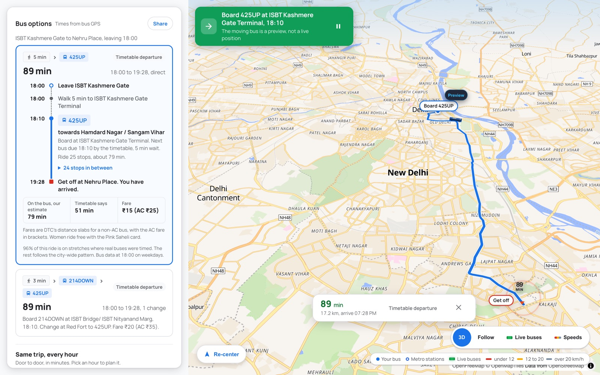

</div>

<br/>

## Why it's better

Delhi's timetable gives every trip one travel time, all day. Traffic doesn't work like that.
This planner gives you the time for **the hour you actually leave**.

<table>
<tr>
<td align="center" width="25%"><h2>40%</h2>smaller error.<br/>Off by 3½ min on average.<br/>The timetable: almost 6.</td>
<td align="center" width="25%"><h2>3 in 4</h2>trips predicted within 20% of the real time.<br/>The timetable: 2 in 5.</td>
<td align="center" width="25%"><h2>24 of 24</h2>hours of the day where it beats the timetable.</td>
<td align="center" width="25%"><h2>+31 min</h2>the timetable hides at 6 pm on Kashmere Gate to Nehru Place: 79 min, not 48.</td>
</tr>
</table>

<sub>Measured on 50,000 real bus trips from a week the model never saw. Details in [Accuracy](#accuracy).</sub>

<p align="center">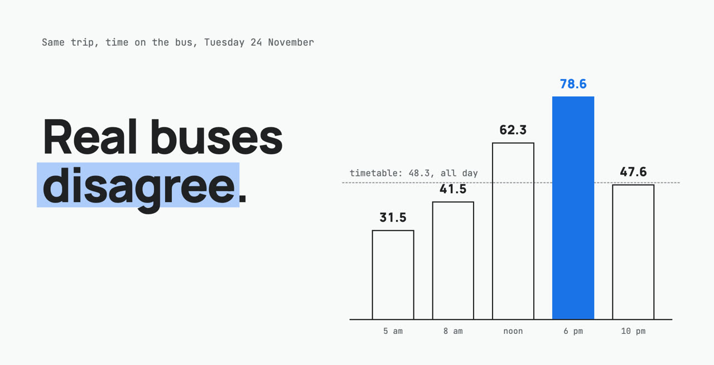</p>

## Run it in a minute

You need **Python 3.10 or newer** and git. No API key, no GPU, no database: the trained model ships
with the code.

```bash
git clone https://github.com/Aryanban/transport-stack-hackathon-2026.git delhi-bus-times
cd delhi-bus-times
python3 -m venv .venv && source .venv/bin/activate
pip install -r requirements.txt
python -m uvicorn src.ps1.api:app --port 8020
```

Open **http://127.0.0.1:8020** and plan a trip. Install takes about 10 seconds. The first plan takes
about 10 seconds while the bus network loads, and every plan after that about 0.2 s.

<details>
<summary><b>Windows (PowerShell)</b></summary>

```powershell
git clone https://github.com/Aryanban/transport-stack-hackathon-2026.git delhi-bus-times
cd delhi-bus-times
py -m venv .venv
.venv\Scripts\Activate.ps1
pip install -r requirements.txt
python -m uvicorn src.ps1.api:app --port 8020
```

If PowerShell blocks the activate script, first run
`Set-ExecutionPolicy -Scope Process -ExecutionPolicy Bypass` in the same window.

</details>

<details>
<summary><b>Something not working?</b></summary>

| What you see | What to do |
| --- | --- |
| `address already in use` | Another app has port 8020. Use `--port 8030` and open http://127.0.0.1:8030 |
| `python3: command not found` | Install Python from [python.org](https://www.python.org/downloads/). On Windows, use `py` |
| `No module named uvicorn` | The environment isn't active. Run `source .venv/bin/activate` again |
| The map is blank | Map tiles load from the internet. Check your connection and reload |
| "No live buses" | Expected without a key. Everything else works. See *Live buses* below |

</details>

<details>
<summary><b>Live buses (optional)</b></summary>

Live buses on the map, and live delays for trips leaving now, need a free Delhi Transport Stack key.

1. Register at [delhi.transportstack.in](https://delhi.transportstack.in) and request the GTFS-RT feed.
2. Copy `.env.example` to `.env` and put your key after `DTS_API_KEY=`.
3. Restart the server.

Without a key the planner uses the learned model and shows no live buses. Nothing is ever simulated.

</details>

**Try these trips** with the server running:

| Trip | What you'll see |
| --- | --- |
| [Kashmere Gate ISBT → Nehru Place](http://127.0.0.1:8020/?from=Kashmere%20Gate%20ISBT&to=Nehru%20Place) | 32 min on the bus at 5 am, 79 at 6 pm. The timetable says 48 all day |
| [Anand Vihar ISBT → Connaught Place](http://127.0.0.1:8020/?from=Anand%20Vihar%20ISBT&to=Connaught%20Place) | Across the Yamuna at 6 pm: 55 min on board. The timetable says 40 |
| [AIIMS → Dhaula Kuan](http://127.0.0.1:8020/?from=AIIMS&to=Dhaula%20Kuan) | Ring Road: 16 min at 8:30 am, 31 min at 6 pm. The timetable says about 20 |

## See it

<a href="docs/media/delhi-bus-times.mp4">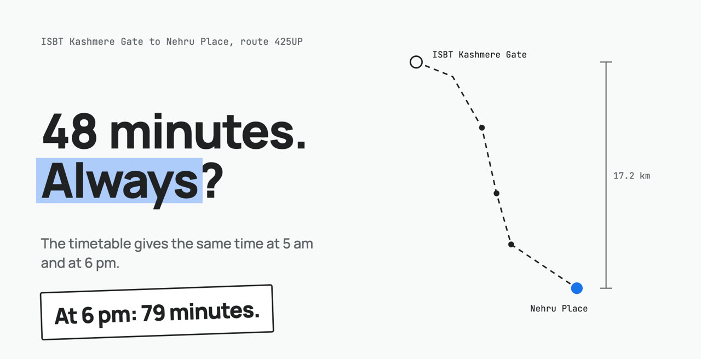</a>

<p align="center"><a href="docs/media/delhi-bus-times.mp4"><b>▶ Watch the 69-second video</b></a></p>

<table>
<tr>
<td width="50%">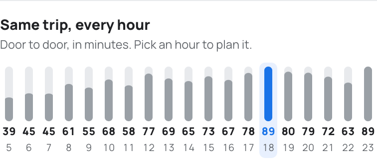<br/><b>Pick a better hour.</b> The same trip at every hour of the day. Tap one to plan it.</td>
<td width="50%">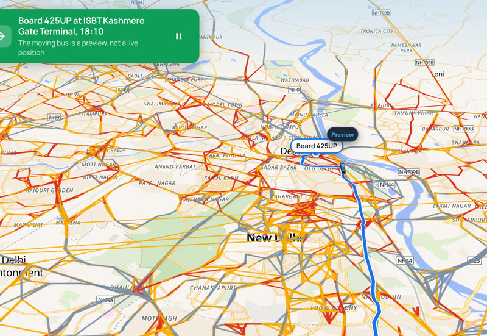<br/><b>See every road's speed.</b> Each stretch coloured by how fast buses move at that hour.</td>
</tr>
<tr>
<td width="50%">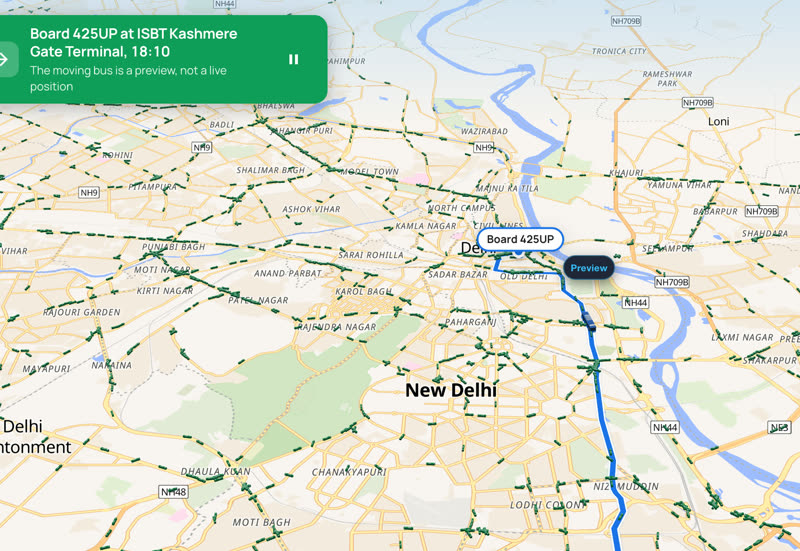<br/><b>Watch live buses.</b> Every bus reporting right now, on the map.</td>
<td width="50%">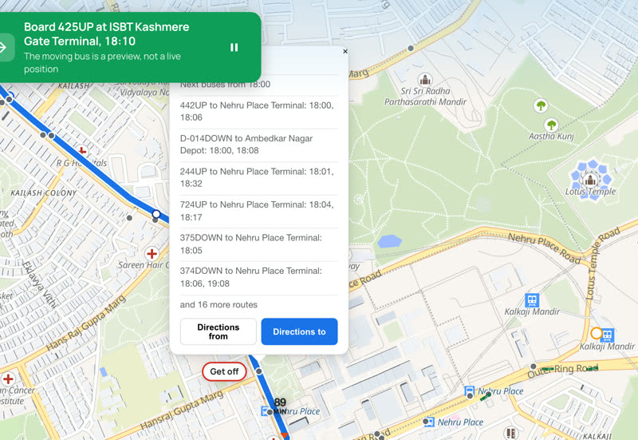<br/><b>Next buses at any stop.</b> Tap a stop to see what's coming.</td>
</tr>
</table>

You can also look up any bus by number (try `534`), start from your current location, and share a
plan as a link. Every option says how much of the ride is timed by real buses, so you know how far
to trust it.

## How it works

The planner is only as good as its model, and the model is only as good as its data. Most of the
work went into turning a raw GPS dump into clean, timed trips.

<table>
<tr>
<td width="50%">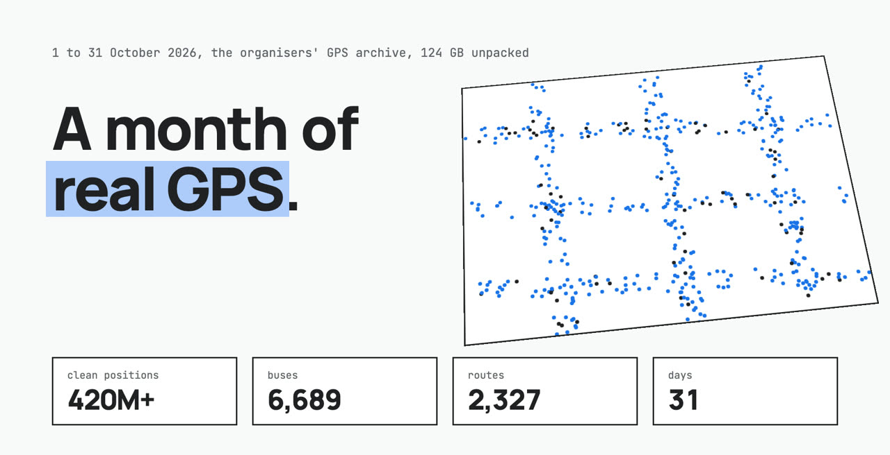<br/><b>1. Collect.</b> 31 days of GPS from Delhi's buses, 124 GB unpacked. After cleaning: 420+ million positions.</td>
<td width="50%">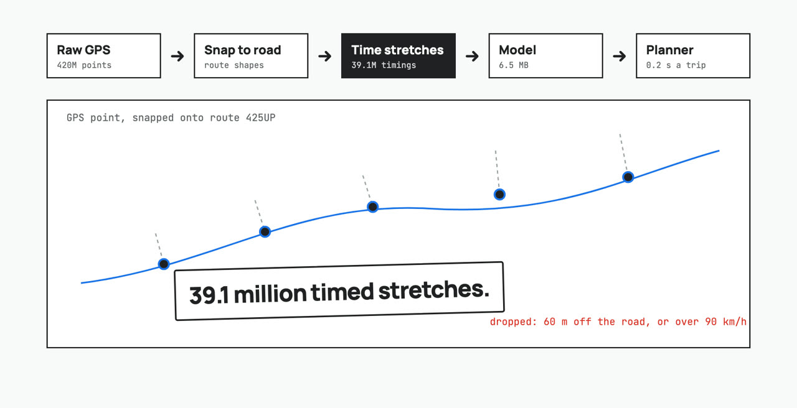<br/><b>2. Snap and time.</b> Every point is snapped onto its bus's route. Bad points are dropped. The bus is timed between every pair of stops: 39.1 million timings.</td>
</tr>
<tr>
<td width="50%">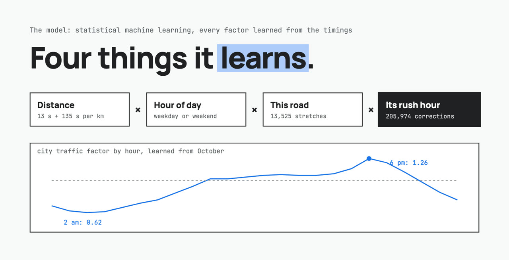<br/><b>3. Learn.</b> The model learns four things: distance, the hour, each road, and each road's own rush hour.</td>
<td width="50%">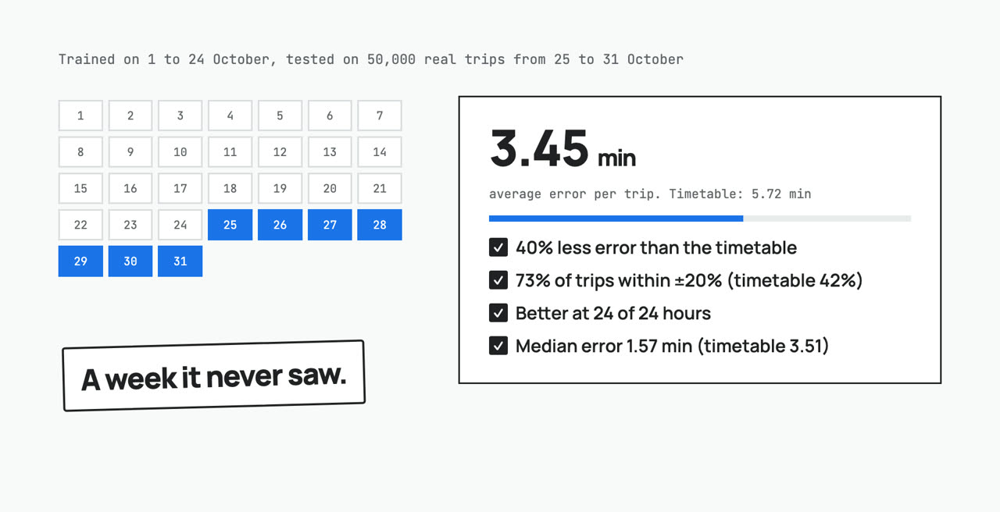<br/><b>4. Prove.</b> Trained on 1 to 24 October, tested on 25 to 31 October: 50,000 trips it never saw.</td>
</tr>
</table>

### Architecture

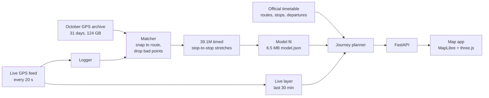

| Part | What it is | Where |
| --- | --- | --- |
| Data pipeline | Unpacks one day of GPS at a time, snaps it to routes, writes timed stretches | `src/ps1/october.py`, `matcher.py` |
| Model | Fits the four factors below from the timed stretches. Pure numpy and pandas | `src/ps1/model.py` |
| Planner | Direct and one-change bus trips, timed hour by hour along the ride, with walking and fares | `src/ps1/planner.py` |
| Live layer | Optional. Adjusts trips leaving now using the last 30 minutes of the live feed | `src/ps1/live.py` |
| API and app | FastAPI server and a plain JavaScript map app. No build step | `src/ps1/api.py`, `src/ps1/web/` |

## The maths

The time for a bus to cover one stretch $s$ (stop to stop, length $L_s$) at hour $h$ on day type $d$
(weekday or weekend):

```math
t_s(h,d) \;=\; \underbrace{(a + b\,L_s)}_{\text{distance}} \;\cdot\; \underbrace{R_{d,h}}_{\text{city traffic at that hour}} \;\cdot\; \underbrace{K_s}_{\text{this road}} \;\cdot\; \underbrace{K_{s,h}}_{\text{this road at that hour}}
```

1. **Distance.** $a + bL$ is fitted by least squares on 20 distance-bin medians:
   $a = 13$ s (stops and doors), $b = 135$ s per km.
2. **City traffic.** $R_{d,h}$ is the median of $t / (a + bL)$ over every trip at that hour and day
   type. It runs from 0.62 at 2 am to 1.26 at 6 pm. Hours with fewer than 30 trips borrow the
   nearest hour.
3. **Each road.** Take the log residual of every observed trip, clipped against bad matches:
   $e = \text{clip}\big(\ln \tfrac{t}{(a+bL) R_{d,h}}, \pm 1.5\big)$. Then

```math
K_s = \exp\left(\frac{\sum e}{n_s + 5}\right), \qquad
K_{s,h} = \exp\left(\frac{\sum (e - \ln K_s)}{n_{s,h} + 3}\right)
```

   The $+5$ and $+3$ shrink each factor toward 1. A road seen a handful of times stays close to
   the city pattern; a road seen thousands of times follows its own data.

4. **A whole journey** is walk + wait + the sum of $t_s$ over its stretches. Each stretch uses the
   hour the bus reaches it, so a trip that runs into rush hour slows down partway.
5. **Live (optional).** For trips leaving now, each stretch's last-30-minute speed ratio (shrunk the
   same way, weight 3) is applied, fading linearly to nothing for trips an hour away.

The fitted model has 13,525 road stretches and 205,974 road-and-hour corrections, in one 6.5 MB file.
The [technical note](docs/hackathon/PS1_SUBMISSION.md) has the full method and validation.

## Accuracy

Trained on 1 to 24 October 2026, tested on 50,000 bus trips from 25 to 31 October.

| | Average error | Typical error | Within ±20% |
| --- | --- | --- | --- |
| **This model** | **3.45 min** | **1.57 min** | **73%** |
| Official timetable | 5.72 min | 3.51 min | 42% |
| One speed for the whole city | 5.88 min | 3.83 min | 40% |

<details>
<summary><b>By time of day, and against Google Maps</b></summary>

<br/>

| | Model | Timetable |
| --- | --- | --- |
| Peak hours (8 to 10 am, 5 to 8 pm) | 3.82 min | 6.04 min |
| Off-peak | 3.16 min | 5.48 min |
| 6 pm, the worst hour | 5.50 min | 9.31 min |
| 5 am | 1.51 min | 6.43 min |

The model predicts the typical (median) time, so it runs about 2 min short on average: a few very
slow trips pull the average up.

**Against Google Maps.** 33 trips (11 Delhi pairs at 8:30 am, 2 pm and 9:30 pm), Google's best
bus-only option read by hand on 17 November 2026. Our door-to-door time is within ±20% of Google's
on 61% of trips. Most of the gap is one pair, Dhaula Kuan to ITO, where Google's best bus takes 92 to
121 min and ours 38 to 62. Google's bus times are timetable estimates too, so this is a comparison,
not ground truth. Data: `data/ps1/google_benchmark.csv`.

</details>

The full report, hour by hour, is at **http://127.0.0.1:8020/accuracy** in the app.

## More

<details>
<summary><b>API</b></summary>

<br/>

Every screen is built on a JSON API. Interactive docs: http://127.0.0.1:8020/docs

```bash
curl "http://127.0.0.1:8020/journeys?from=Kashmere%20Gate%20ISBT&to=Nehru%20Place&depart=08:30"
```

| Endpoint | What it returns |
| --- | --- |
| `GET /journeys?from=&to=&depart=` | Up to 3 journey options with legs, times, fares and directions |
| `GET /journeys/day?from=&to=&date=` | Door-to-door time for the same trip at each hour |
| `GET /stops?q=` | Stops matching a name |
| `GET /stops/all` | Every served stop as GeoJSON |
| `GET /stops/{id}/departures` | Next buses at a stop |
| `GET /routes?q=` | Routes matching a bus number |
| `GET /routes/{id}` | A route's path, stops, first and last bus, and how often it runs |
| `GET /traffic/hours` | City-wide traffic factor by hour and day type |
| `GET /traffic/stretches?hour=&daytype=` | Predicted speed on each stretch, as GeoJSON |
| `GET /live/status` | Live feed status |
| `GET /live/vehicles?route=` | Live bus positions, optionally for one route |
| `GET /metro/network` | Metro stations, for map context |
| `GET /validation` | The held-out accuracy report |

</details>

<details>
<summary><b>Rebuild the model from raw GPS</b></summary>

<br/>

Not needed to run the app. It takes about 20 GB of free disk, 16 GB of RAM and 3 hours.

1. Download the October archive (16.1 GB) from the
   [Transport Stack hackathon page](https://delhi.transportstack.in/hackathon/) into `data/raw/` and
   check it against the published `SHA256SUMS`.
2. Install 7-Zip (`brew install sevenzip` on a Mac).
3. Turn each day into timed stretches, then fit and test:

```bash
python -m src.ps1.october
python -m src.ps1.model && python -m src.ps1.validation
```

To add your own live data, run `python scripts/log_gtfs_rt.py` (needs a key), then
`python -m src.ps1.matcher` before fitting.

</details>

<details>
<summary><b>Honest limits</b></summary>

<br/>

- **Cluster buses** (DIMTS) have less data: the October archive is DTC buses only. Every option
  shows how much of its ride rests on timed stretches.
- **No holiday or weather factor** yet. Weekdays and weekends only.
- **It predicts the typical time.** The worst trips on a bad day take longer.
- **At most one change of bus.** Metro stations are shown for reference only.
- **The wait for the first bus** uses the timetable unless a live bus is on its way.
- **No crowding levels** yet.

</details>

<details>
<summary><b>Repository layout</b></summary>

<br/>

```
src/ps1/                 planner, model, GPS matcher, live layer, API and web app
src/gtfs_rt_client.py    live feed client (live data only, never simulated)
scripts/log_gtfs_rt.py   logs the live feed to data/gps_log/
data/delhi_buses_gtfs/   official timetable (GTFS)
data/ps1/                trained model, validation report, Google benchmark
docs/                    technical note, images and the video
tests/                   test suite: python -m pytest tests/ -q
```

</details>

## Credits

Built by [@Aryanban](https://github.com/Aryanban). Started at the
[Transport Stack Hackathon 2026](https://whereuelevate.com/drills/transport-stack-hackathon-2026?w_ref=J66P10)
(Problem 1, bus travel time).

- **Data:** Delhi Transport Stack (timetable, live feed and the October 2026 bus GPS archive, IIIT
  Delhi) and DMRC metro station locations.
- **Map:** [MapLibre GL](https://maplibre.org) and [OpenFreeMap](https://openfreemap.org), map data ©
  OpenStreetMap contributors.
- **Video voice:** Microsoft neural TTS.
