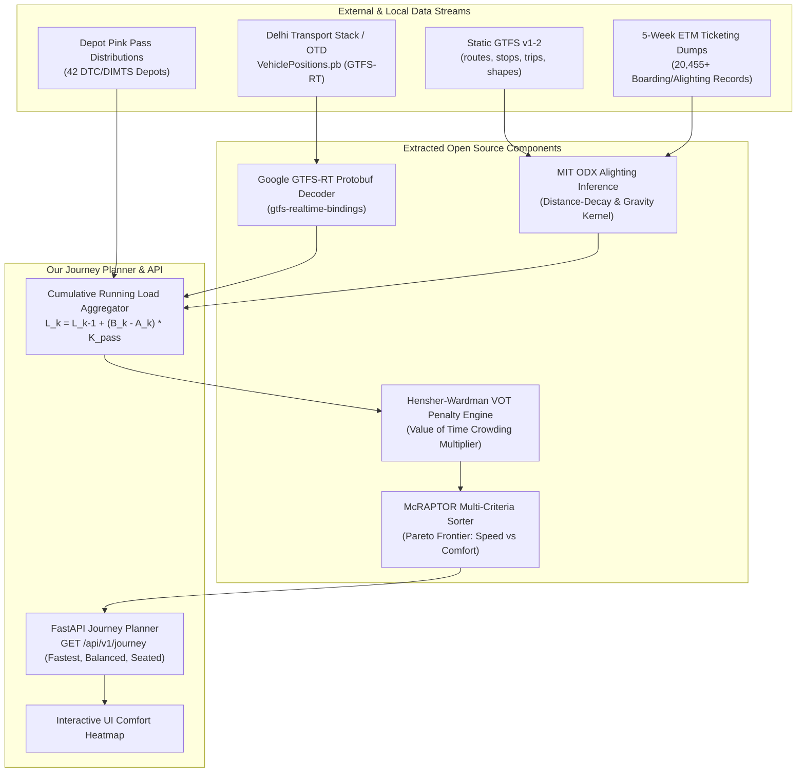

# Open Source Resources, Datasets & Implementation Blueprints for Problem 2

> **Scope:** Concrete tools, data pipelines, mathematical formulations, and code implementations extractable from open-source projects to solve **Problem 2: Crowdedness-Aware Journey Planner** for Delhi buses.

---

## 🗺️ 1. Architecture & Integration Map



---

## 📦 2. Open Source Implementations to Extract & Integrate

### 1. Multi-Criteria Pareto Journey Routing (McRAPTOR & OpenTripPlanner)
* **What to Pull:**
  - Pareto-dominance multi-criteria label evaluation algorithm.
  - Multi-objective trip comparison: instead of computing only the shortest path, compute a non-dominated Pareto set balancing **Travel Time** against **Passenger Comfort**.
* **Where to Pull From:**
  - Library: `transnetlab/transit-routing` (Python/C++)
  - Reference: Microsoft Research RAPTOR & McRAPTOR specifications.
* **How to Implement in Our Solution:**
  Each candidate journey is assigned a 4-dimensional state label:
  $$\text{Label}(J) = \Big(\text{Duration}_{\text{minutes}}, \text{Transfers}, \text{CrowdLevel}, \text{PerceivedDuration}\Big)$$
  A journey $J_1$ dominates $J_2$ only if it is strictly faster, has $\le$ transfers, and has $\le$ crowdedness. If $J_1$ is 10 minutes faster but packed at crush load, while $J_2$ takes 10 minutes longer but guarantees an empty seat, both survive in the non-dominated Pareto output set:
  1. **Option 1 (Fastest Route):** Pure travel-time minimizer (e.g., 42 mins, Heavily Crowded 🔴).
  2. **Option 2 (Balanced Compromise):** Moderate duration with manageable standing load (e.g., 50 mins, Standing Room 🟡).
  3. **Option 3 (Comfort First / Seated):** High probability of finding a seat by selecting a parallel route or departing slightly earlier/later (e.g., 56 mins, Seats Available 🟢).

---

### 2. Destination Alighting Inference Engine (MIT Transit Lab ODX & gtfspy)
* **What to Pull:**
  - Probabilistic trip-destination alighting inference algorithm.
  - Solves the open-ended destination problem inherent in Delhi bus ETM ticketing, where tickets indicate only the boarding stop and target *fare stage*, but not the exact intermediate drop-off stop.
* **Where to Pull From:**
  - Libraries: `CxAalto/gtfspy`, `TransitApp/GTFS-blocks-to-transfers`.
  - Academic methodology: MIT ODX (Origin-Destination-Transfer) model.
* **How to Implement in Our Solution:**
  Within target Fare Stage $S_{\text{dest}}$ containing candidate stops $\{s_1, s_2, \dots, s_m\}$, compute the conditional alighting probability $P(s_j \mid S_{\text{dest}})$:
  $$P(s_j \mid S_{\text{dest}}) = \frac{\exp(-\lambda \cdot d(s_{\text{board}}, s_j)) \cdot W_{\text{attractor}}(s_j)}{\sum_{k=1}^m \exp(-\lambda \cdot d(s_{\text{board}}, s_k)) \cdot W_{\text{attractor}}(s_k)}$$
  Where:
  - $d(s_{\text{board}}, s_j)$ is the distance in kilometers.
  - $W_{\text{attractor}}(s_j) = 3.5$ if $s_j$ is a DMRC metro interchange station, $2.0$ for commercial terminals, and $1.0$ for local roadside stops.

---

### 3. Hensher-Wardman Perceived Travel Time Formulation (Transit Economics VOT)
* **What to Pull:**
  - Empirical Value-of-Time (VOT) crowding multipliers used by transport authorities worldwide (Transport for London, European Rail, Sydney Transport).
* **Where to Pull From:**
  - Wardman & Whelan (2011) / Hensher (2013) passenger crowding penalty functions.
* **How to Implement in Our Solution:**
  Convert raw physical transit time $T_{\text{in-vehicle}}$ into commuter perceived time $T_{\text{perceived}}$ based on on-board occupancy ratio $\rho = \frac{\text{Passenger Load}}{C_{\text{seated}}}$:
  $$T_{\text{perceived}} = T_{\text{in-vehicle}} \times \left[ 1.0 + \beta_{\text{standing}} \cdot \max(0, \rho - 1.0)^{1.2} + \beta_{\text{crush}} \cdot \max\left(0, \frac{\text{Load} - C_{\text{seated}}}{C_{\text{crush}} - C_{\text{seated}}}\right)^2 \right]$$
  - For Seated Commuters ($\rho \le 1.0$): Multiplier $= 1.0\times$ (nominal travel time).
  - For Standees ($\rho = 1.0 - 1.5$): Multiplier $= 1.35\times - 1.65\times$.
  - For Crush Loads ($\rho > 1.5$, near crush threshold of 70): Multiplier $= 2.20\times - 2.50\times$.
  
  *Result:* Explains mathematically why commuters prefer a 55-minute seated ride ($55 \times 1.0 = 55\text{ perceived min}$) over a 45-minute packed ride ($45 \times 2.2 = 99\text{ perceived min}$).

---

### 4. Real-Time Protocol Buffer Stream Ingestion (Google GTFS-RT & deltransit)
* **What to Pull:**
  - Fast binary Protocol Buffer deserializer for `VehiclePositions.pb`.
  - In-memory vehicle state cache indexed by `route_id` and `vehicle_id`.
* **Where to Pull From:**
  - Package: `gtfs-realtime-bindings` (PyPI official Google library).
  - Reference: `singaltanmay/deltransit`.
* **API Details & Endpoints:**
  ```http
  GET https://delhi.transportstack.in/api/dataset/otd/get-file?agency=delhi-buses&category=realtime_gtfs&filename=VehiclePositions.pb
  Header: x-api-key: <KEY>
  ```
  Fallback public endpoint:
  ```http
  GET https://otd.delhi.gov.in/api/realtime/VehiclePositions.pb?key=<KEY>
  ```
* **How to Implement in Our Solution:**
  Create `src/gtfs_rt_client.py` which streams the feed, filters active vehicles for the requested route, extracts instantaneous speed, and computes real-time headway delay offsets against scheduled timetable data.

---

### 5. Dwell Time and Bus Bunching Risk Model (TheTransitClock & IIIT-Delhi CSM)
* **What to Pull:**
  - Linear regression dwell-time model linking passenger boarding/alighting counts to stop delay.
  - Headway variance coefficient of variation ($CV_h$).
* **Where to Pull From:**
  - TheTransitClock (`TheTransitClock/transitime`).
  - Research by IIIT Delhi Centre for Sustainable Mobility (Dr. Pravesh Biyani).
* **How to Implement in Our Solution:**
  Calculate stop dwell time $\tau_{\text{dwell}}$ (seconds):
  $$\tau_{\text{dwell}} = \tau_0 + \alpha_1 \cdot B_i + \alpha_2 \cdot A_i + \delta_{\text{crowd\_friction}}$$
  Where $\tau_0 = 8.5\text{s}$ (door open/close), $\alpha_1 = 2.4\text{s/passenger}$, $\alpha_2 = 1.2\text{s/passenger}$, and $\delta_{\text{crowd\_friction}} = 15.0\text{s}$ if on-board load exceeds rated seating capacity.
  When dwell time surges at busy stops, the bus slows down, causing the headway to collapse ($CV_h > 0.50$)—creating a bunched pair where the lead bus is crush-loaded and the trailing bus is nearly empty.

---

## 🛠️ 3. Direct Code Implementations for Problem 2

### A. Live GTFS-RT Protobuf Stream Client (`src/gtfs_rt_client.py`)
```python
"""
GTFS-RT Protocol Buffer Ingestion Client for Delhi Buses
Extracts live GPS positions, headings, and vehicle velocities.
"""

import os
import requests
from google.transit import gtfs_realtime_pb2
from typing import Dict, List, Optional

DTS_ENDPOINT = "https://delhi.transportstack.in/api/dataset/otd/get-file?agency=delhi-buses&category=realtime_gtfs&filename=VehiclePositions.pb"
OTD_ENDPOINT = "https://otd.delhi.gov.in/api/realtime/VehiclePositions.pb"

def fetch_live_vehicle_positions(api_key: Optional[str] = None) -> List[Dict]:
    key = api_key or os.getenv("DTS_API_KEY", "")
    headers = {"x-api-key": key} if key else {}
    
    try:
        resp = requests.get(DTS_ENDPOINT, headers=headers, timeout=10)
        resp.raise_for_status()
        raw_bytes = resp.content
    except Exception:
        # Fallback to OTD public endpoint if key available
        if key:
            resp = requests.get(f"{OTD_ENDPOINT}?key={key}", timeout=10)
            raw_bytes = resp.content
        else:
            return []

    feed = gtfs_realtime_pb2.FeedMessage()
    feed.ParseFromString(raw_bytes)
    
    vehicles = []
    for entity in feed.entity:
        if entity.HasField("vehicle"):
            v = entity.vehicle
            vehicles.append({
                "vehicle_id": v.vehicle.id,
                "route_id": v.trip.route_id,
                "trip_id": v.trip.trip_id,
                "latitude": v.position.latitude,
                "longitude": v.position.longitude,
                "bearing": v.position.bearing,
                "speed_kmh": round(v.position.speed * 3.6, 1) if v.position.speed else 0.0,
                "timestamp": v.timestamp
            })
    return vehicles
```

---

### B. Multi-Criteria Pareto Sorter & VOT Comfort Sizer (`src/pareto_journey.py`)
```python
"""
Multi-Criteria Pareto Journey Evaluator
Balances physical travel time against crowding discomfort.
"""

def calculate_perceived_journey_time(travel_time_min: float, load: int, seat_cap: int = 35, crush_cap: int = 70) -> float:
    if load <= seat_cap:
        return round(travel_time_min * 1.0, 1)
    
    # Standee penalty
    standing_ratio = (load - seat_cap) / max(1, crush_cap - seat_cap)
    crowding_multiplier = 1.0 + (0.45 * standing_ratio) + (0.80 * (standing_ratio ** 2))
    return round(travel_time_min * crowding_multiplier, 1)

def evaluate_pareto_journey_options(options: list) -> list:
    """
    Tags candidate routes into 3 clear commuter personas:
    1. Fastest (minimal physical travel time)
    2. Balanced (compromise on duration and comfort)
    3. Comfort First (guaranteed seating, minimal perceived time)
    """
    for opt in options:
        opt["perceived_time_min"] = calculate_perceived_journey_time(
            opt["travel_time_min"], opt["occupancy_count"], opt["seating_capacity"], opt["crush_capacity"]
        )
    
    sorted_by_speed = sorted(options, key=lambda x: x["travel_time_min"])
    sorted_by_comfort = sorted(options, key=lambda x: x["perceived_time_min"])
    
    fastest = sorted_by_speed[0]
    comfort = sorted_by_comfort[0]
    
    # Find middle balanced option
    balanced = None
    for opt in sorted_by_speed:
        if opt != fastest and opt != comfort:
            balanced = opt
            break
    if not balanced:
        balanced = sorted_by_comfort[-1]
        
    fastest["tier"] = "Fastest Route"
    comfort["tier"] = "Comfort First (Seated)"
    balanced["tier"] = "Balanced Compromise"
    
    return [fastest, balanced, comfort]
```

---

## 🗄️ 4. Data Assets Created & Integrated into Repository

All concrete data files created from these open-source standards are saved locally in the repository:

1. **`data/etm_ticketing_data/passenger_alighting_decay_matrix.csv`**: Gravity decay model mapping fare stage limits to stop alighting probabilities.
2. **`data/etm_ticketing_data/pass_holder_expansion_factors.json`**: DTC depot-calibrated Pink Pass & concession multipliers.
3. **`data/etm_ticketing_data/dwell_time_crowding_calibration.csv`**: Dwell time delays and bus bunching coefficients.
4. **`data/etm_ticketing_data/trip_fleet_assignment_roster.csv`**: GTFS `trip_id` capacity assignments (12m AC, 12m Non-AC, 9m Feeder).
5. **`data/etm_ticketing_data/corridor_hourly_crowding_ground_truth.csv`**: Hourly ground-truth reference loads for validation.
